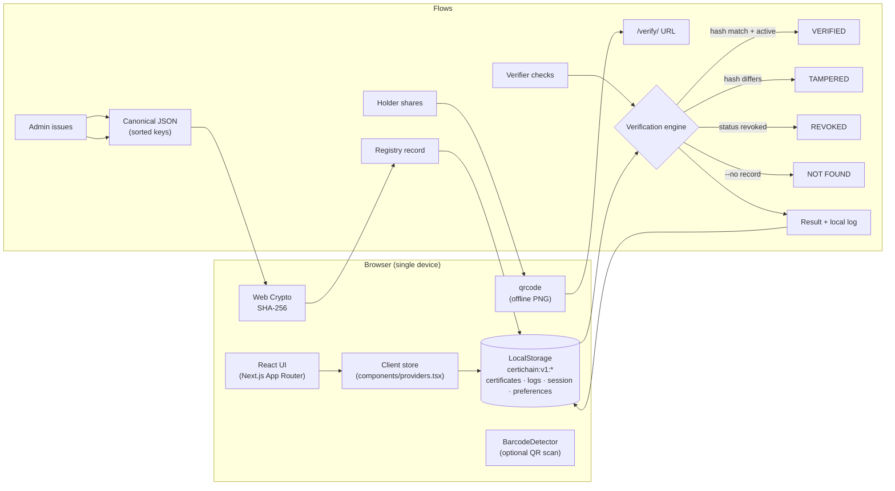

# CertiChain — Verify Every Credential

**Blockchain-inspired digital certificate issuance and verification system.**
Team **Cyber Core** · HackIndia AI & CyberTech Hackathon 2026 · Cybersecurity track (Fraud Detection & Identity Verification).

> Trust on paper is not enough. Verify every credential.

Live flows: **issue → SHA-256 fingerprint → QR share → verify → tamper-detect → revoke**, all running in the browser with **no backend**.

---

## 1. What it is

CertiChain demonstrates how digital credentials can be issued with validated metadata, given a deterministic **SHA-256 fingerprint** (via the browser Web Crypto API), shared as a **QR code / verification link**, independently checked by anyone, and **revoked** — with an edit of even one character producing an instant hash mismatch.

It is a **frontend-only hackathon MVP**: Next.js 16 + React 19 + TypeScript (strict) + Tailwind CSS v4, persisting to browser LocalStorage. There is no custom backend, no database service, no authentication server, and no blockchain node. The app is fully deployable as a standard Next.js site (e.g. Vercel).

## 2. Problem statement

- Forged academic certificates are cheap to produce and hard to disprove.
- Manual verification by employers takes days to weeks of phone/email ping-pong.
- There is no universal, instant verification experience.
- Credential paperwork creates trust that outlives its verifiability.

## 3. Solution overview

| Role experience | What they do |
| --- | --- |
| **Admin / institution** | Issues certificates with validation, manages the registry, revokes with an audit trail |
| **Student / holder** | Wallet of certificates, QR codes, share links, print/“Save as PDF” certificates |
| **Verifier / employer** | Checks by ID, link, QR scan, or raw file fingerprint — no account required |

Verification results are explicit and non-negotiable:
`VERIFIED` (hash matches, record active) · `TAMPERED` (hash mismatch — explained by field) · `REVOKED` (beats every other result) · `NOT FOUND` · `INVALID INPUT` · `RECORD FOUND` (bare-ID lookup only — never reported as verified, since no hash was compared).

## 4. Team Cyber Core

- Abhay Saini
- Sarthak Srivastava
- Shweta
- Aman Yadav

Institution: **Dr. Virendra Swarup Institute of Computer Studies, Kanpur**.

## 5. Features

- Polished marketing landing page with a **live interactive demo** (real registry, not mock).
- Simulated demo roles (admin / student / verifier) with role-aware navigation — persistence and switching included.
- Full issuance form: validation (required fields, dates, email, duplicate-ID rejection, length limits), auto-generated collision-checked IDs, optional **original-document fingerprint** (raw bytes captured at issue time).
- Deterministic fingerprinting: normalized metadata → canonical JSON (sorted keys, empties dropped) → `crypto.subtle.digest("SHA-256")` → 64-char lowercase hex, displayed with copy actions and technical explanation.
- QR codes for every certificate (preview, PNG download, embedded in the printable sheet); verification URLs are plain deep links (`/verify/<ID>`).
- Verification portal open to visitors: certificate ID, pasted link, camera QR scan (native `BarcodeDetector` where available, graceful fallback everywhere), manual entry, raw-byte file checks when a document fingerprint exists.
- Tampering demonstration with one click on any verification page; results name the differing field(s).
- Revocation with confirmation dialog; persisted; reflected in admin/student/verifier views; fingerprint retained. Un-revoke (demo undo) available.
- Verification history: searchable, filterable, JSON-exportable.
- Dashboard metrics computed only from actual local records (status donut, result bars, recent activity) — clearly labeled as local data.
- Settings: profile switch, restore demo data, erase **only** `certichain:v1:*` keys, storage diagnostics, security statement.
- Custom not-found page, empty/error/loading states, keyboard-accessible dialogs, reduced-motion support, responsive desktop/tablet/mobile layouts.

## 6. Technology stack

- **Next.js 16.4** (App Router, Turbopack build, typed routes, partial prerendering)
- **React 19.3**
- **TypeScript** strict mode
- **Tailwind CSS v4**
- **Web Crypto API** — SHA-256 hashing (metadata fingerprint, file fingerprint)
- **qrcode** — local QR generation (no network)
- **Lucide React** — icons
- **LocalStorage** — `certichain:v1:*` namespaced, versioned keys
- **Vitest** — 40 domain/integration tests
- **Browser print-to-PDF** — printable certificate sheet with embedded QR
- `BarcodeDetector` (native, Chromium) — optional camera QR scanning

## 7. Application structure

```
certichain/
├── app/
│   ├── page.tsx                  # landing page (+ live check demo)
│   ├── login/                    # demo role selection
│   ├── not-found.tsx             # custom 404
│   ├── certificates/[id]/print/  # printable certificate sheet
│   ├── verify/                   # public verification portal
│   │   └── [id]/                 # deep-link verification page
│   └── (app)/                    # dashboard shell area
│       ├── dashboard/            # role-aware overview (metrics from real data)
│       ├── admin/                # overview (reuses overview), issue/,
│       │   └── certificates/[id] # registry + details
│       ├── student/certificates/ # credential wallet
│       ├── history/              # verification history
│       └── settings/             # profile, data management
├── components/                   # design system, shell, QR, scanner, result UI
├── lib/
│   ├── types.ts                  # domain types
│   ├── hash.ts                   # SHA-256 + canonical serialization
│   ├── validation.ts             # pure input validation
│   ├── storage.ts                # namespaced LocalStorage layer
│   ├── certificates.ts           # registry: issue / revoke / lookup / sort
│   ├── verification.ts           # decision engine + logging
│   ├── metrics.ts                # dashboard derivations
│   ├── demo-data.ts              # synthetic seed data + seeding rules
│   └── format.ts                 # formatting helpers
├── tests/                        # vitest suites (40 tests)
├── docs/DEMO_GUIDE.md            # presentation scripts
└── .github/workflows/ci.yml      # lint + typecheck + test + build
```

## 8. Architecture



**Two hash domains, never mixed:**
1. `fingerprint` — canonical **metadata** JSON → SHA-256 (the registry's integrity anchor).
2. `documentSha256` — **raw file bytes** → SHA-256, captured at issue time for later file-integrity checks.

## 9. Installation

```bash
git clone https://github.com/sarvasva-dev/cyber-core.git
cd cyber-core
npm install
```

Requires Node.js ≥ 20 (tested on Node 24, npm 11). No environment variables, API keys, or external services are needed.

## 10. Development & production commands

```bash
npm run dev        # dev server at http://localhost:3000
npm run lint       # ESLint (flat config, eslint-config-next)
npm run typecheck  # tsc --noEmit (strict)
npm test           # vitest run (40 tests)
npm run build      # production build
npm run start      # serve the production build
```

## 11. Vercel deployment

The project follows the standard Vercel Next.js model (no `output: "export"`, no custom server, no required env vars).

1. Push the repository to GitHub (`sarvasva-dev/cyber-core`).
2. In [Vercel](https://vercel.com/new), **Import Git Repository** → select `sarvasva-dev/cyber-core`.
3. Vercel auto-detects **Next.js**; keep the default build command (`next build`) and branch (`main`).
4. Click **Deploy**. No environment variables are required.
5. Open the generated URL and check: `/` landing, `/login` role selection, `/verify` portal, `/admin/issue` issuance, and a direct `/verify/CRT-2025-M88X2Q` deep link.

All cores flows are browser-local, so a fresh deployed site seeds its own demo registry for that browser.

## 12. How to explore the demo

1. Open `/` — try the interactive check on the landing page.
2. Choose a role: `/login` → Admin (issue), Student (wallet), Verifier (verify) — or skip to `/verify` with no role at all.
3. **Verifier**: enter `CRT-2025-M88X2Q` → “Check”. Open its verification page and use **Recompute** (unedited → VERIFIED) and **Simulate tampering** (→ TAMPERED, badge shows the differing field).
4. **Admin**: `/admin/issue` → fill minimal fields → **Fingerprint & issue** → success panel with fingerprint, QR, verification link, print.
5. **Registry**: `/admin/certificates` → revoke `CRT-2025-V7HQ8B` (confirm) → re-verify it anywhere → REVOKED.
6. **Student**: `/login` → Aarav Sharma → `/student/certificates` → wallet with QR, share, print.
7. **History** (any role or visitor): results of every check, filterable, exportable.
8. **Settings**: restore demo data / erase all CertiChain data (only our keys).

### Certificate IDs in the bundled demo registry

| Certificate ID | State | Purpose |
| --- | --- | --- |
| `CRT-2025-M88X2Q` | active | Golden sample — VERIFIED / TAMPERED demo |
| `CRT-2025-K3PL4N` | active | Second active credential (Silverline profile) |
| `CRT-2024-R9VC5D` | revoked | Always REVOKED — even when the hash matches |
| `CRT-2025-V7HQ8B` | active | Revoke this one during a live demo |

## 13. LocalStorage behavior & reset

- Keys: `certichain:v1:certificates`, `certichain:v1:verification-logs`, `certichain:v1:session`, `certichain:v1:preferences`.
- First-run seeding happens **only when the certificates key is absent**; existing user records are never overwritten automatically.
- “Restore demo data” (Settings) replaces only CertiChain’s own keys.
- “Erase all CertiChain data” (Settings) removes only `certichain:v1:*` keys — unrelated website storage is untouched.
- Malformed JSON degrades to empty defaults; quota errors are caught and surfaced.
- Cross-tab updates are handled via the `storage` event.
- **The registry is per-browser.** Records issued on one device are invisible to another device unless shared through this same browser — an honest limitation of the frontend-only model, stated throughout the UI.

## 14. Security model (honest)

> This hackathon MVP uses browser-local data and simulated role selection. It demonstrates client-side credential workflows and cryptographic fingerprinting; it does **not** provide server-enforced authorization, a globally shared registry, or actual Ethereum consensus.

- LocalStorage is **not immutable** — the browser user can read/modify it via devtools.
- Demo roles are presentation state, not authentication.
- A SHA-256 fingerprint detects changes to the hashed **data**; it does not prove a real qualification was genuinely awarded.
- Revocation is local demo state, not an irreversible on-chain operation.
- Uploaded files are hashed in-memory and never sent anywhere.
- No secrets, tokens, or environment variables exist in the codebase.

## 15. Tests executed & results

| Command | Result |
| --- | --- |
| `npx tsc --noEmit` | ✅ 0 errors |
| `npm run lint` | ✅ 0 errors (13 stylistic warnings) |
| `npm test` (vitest) | ✅ 40/40 passed (2 files) |
| `npm run build` | ✅ 17 routes, successful production build |

Covered domain behaviours include: SHA-256 known vector; deterministic fingerprints stable under property order; changed-field → different hash; duplicate-ID rejection; VERIFIED / TAMPERED / REVOKED / NOT FOUND / INVALID INPUT transitions; revoked-beats-matching-hash precedence; persistence across simulated reloads (certificates, revocation, logs); seeding never overwrites user data; demo-restore integrity; metrics counting; validation rules.

**Tested interactively in the production browser build:** landing + live VERIFIED/TAMPERED transitions, /verify/[id] full flow, revoked precedence, login → admin redirect, admin issuance end-to-end (fingerprint + QR), registry table, student wallet with QR and check history, verification-history logging, print sheet with embedded QR, 404 route, and direct deep links after refresh.

## 16. Known limitations

- No backend: registry, revocations and roles are browser-local; no cross-device or cross-user verification.
- QR camera scanning relies on the native `BarcodeDetector` (Chromium); Firefox/Safari fall back to manual entry.
- “PDF download” is browser print-to-PDF via a dedicated print sheet.
- No file bytes are stored — only their hash — so file checks require the verifier to possess the same file.
- No server-enforced access control anywhere.
- Single-timeline analytics only (registry sizes are small by design).

## 17. Future roadmap (not implemented — clearly separated)

- Real on-chain anchoring (Ethereum testnet smart contract holding fingerprints; MetaMask flow).
- Issuer-operated backend registry with server-enforced access control and issuing authority.
- Multi-institution onboarding and federated verification.
- Native PDF generation (bytes stored/provable), notarized timestamps.
- AI-assisted document anomaly detection (layout/typography tamper signals).
- DigiLocker / Academic Bank of Credits integrations where APIs permit.
- Secure cross-device credential sharing (encrypted vault, expiry-scoped share links).

---

*CertiChain MVP · Team Cyber Core · HackIndia AI & CyberTech Hackathon 2026 · License: see repository LICENSE.*
